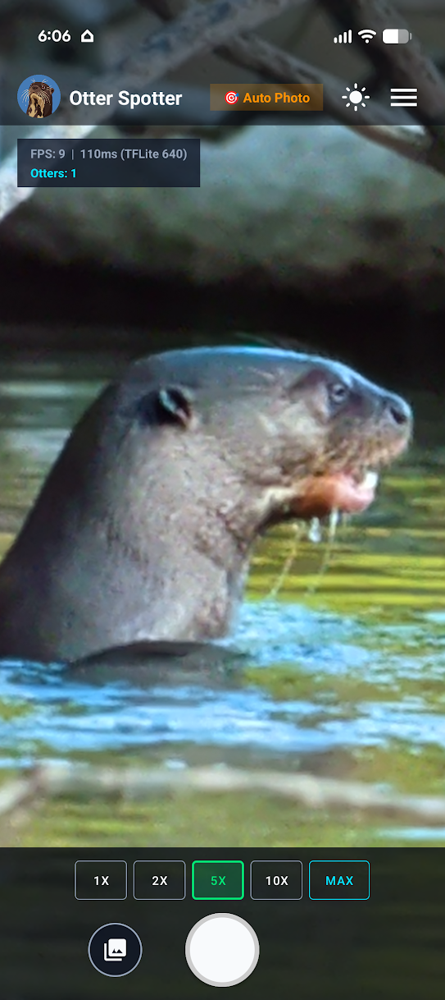
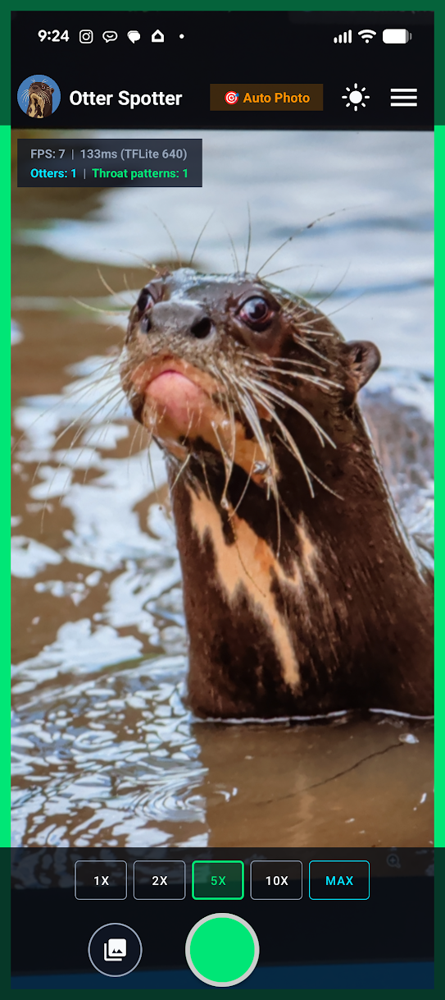

<p align="center">
  
</p>

# Otter Spotter

Otter Spotter is an Android app for collecting photographs of giant otters (*Pteronura brasiliensis*) for individual re-identification. It automatically captures visible throat patterns, records location, and uploads original images when connectivity is available.

The app builds on the [Otter Spotter evaluation](https://github.com/gkyle/otter-spotter-eval), bringing its detection model into the field to test whether a simpler collection workflow improves research data.

**Closed Testing: access is limited to invited participants.** Collaborators can download the app and enroll before observing.

## Why this app?

Re-identification depends on clear photographs of an otter's distinctive throat markings, reliable location data, and verified identities. The [evaluation](https://github.com/gkyle/otter-spotter-eval) exposed four gaps:

- **Many images were not usable for re-identification.** Most images did not contain a sufficient view of an otter's distinctive throat pattern.
- **Original images get lost in the workflow.** Transferring photographs from a camera to a phone or computer adds a follow-up task that contributors may never complete.
- **Locations are often missing or imprecise.** Geography helped matching, but public-source coordinates were frequently absent, unreliable, or obscured.
- **Few individuals have long histories.** More usable photographs across separate encounters would improve the catalog and support stronger evaluation.

Otter Spotter aims to collect useful images and location together, then handle submission automatically.

## How it works

### Frame, hold steady, capture

An on-device model detects when an otter's throat pattern is visible. With **Auto Photo** enabled, the app signals the user to hold steady, checks the detection across successive frames, then **automatically takes the photograph** in less than a second. Detection works offline. Manual capture is also available.

<table width="100%">
  <thead>
    <tr>
      <th width="50%" align="center"><p align="center">No throat pattern visible</p></th>
      <th width="50%" align="center"><p align="center">Throat pattern detected</p></th>
    </tr>
  </thead>
  <tbody>
    <tr>
      <td width="50%" align="center" valign="top">
        
      </td>
      <td width="50%" align="center" valign="top">
        
      </td>
    </tr>
    <tr>
      <td width="50%" align="center" valign="top">Automatic capture waits for a useful view.</td>
      <td width="50%" align="center" valign="top">A stable detection triggers automatic capture.</td>
    </tr>
  </tbody>
</table>

Optical and digital zoom help frame distant animals. Available zoom presets depend on the phone.

### Record location and submit

With location permission enabled, the app attaches the available phone GPS fix to each photograph. Accuracy depends on the device and conditions.

Photos are saved locally and queued for automatic upload when a network is available, even after the app is closed. Background scheduling may delay uploads. The gallery shows submission status.

**All submitted images are reviewed by a human expert for identification.**

## What closed testing will evaluate

- Can phones capture enough throat-pattern detail at realistic distances and in field lighting?
- Does automatic capture produce more useful images and more observations of each individual?
- Does the app encourage sustained community contribution?
- Do better images, precise locations, and richer encounter histories improve re-identification precision and recall?

The pilot must also establish location precision requirements, access controls, and protection for sensitive records.

## Build from source

Development requires JDK 17 or newer and an Android SDK with API 36. The app supports Android 8.0 (API 26) and newer.

Configure your SDK locally through Android Studio, `ANDROID_HOME`, or `android/local.properties`, then build:

```bash
cd android
./gradlew assembleDebug
```

From the repository root, install the debug APK on a connected device with USB debugging enabled:

```bash
adb install -r android/app/build/outputs/apk/debug/app-debug.apk
```

Building the source does not enroll a collaborator or grant access to the closed testing service. Keep local environment configuration and release signing keys outside Git.
